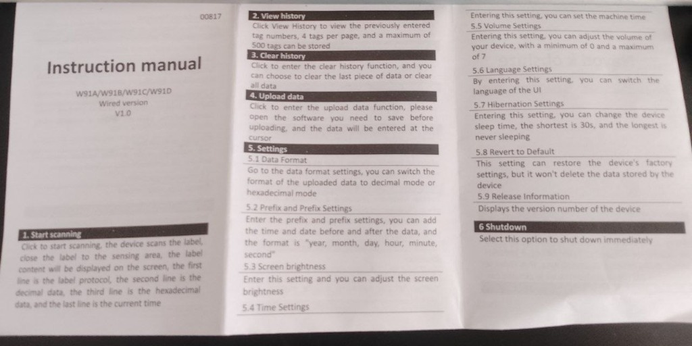

# 🐾 Lector RFID & Planilla Médica PWA (ISO 11784/85)
### Software Propietario de Automatización Clínica y Gestión Veterinaria

  
  
  
  

---

## ⚖️ Declaración de Propiedad Intelectual y Derechos de Autor

> **IMPORTANTE — SOFTWARE PROPIETARIO:**
> Este proyecto, su arquitectura, código fuente, algoritmos, diseño de interfaz y desarrollos asociados son **creación y propiedad exclusiva e intelectual de `tiendastelegram by Kuromi04`**.
>
> **Este software NO le pertenece a ninguna entidad pública, alcaldía ni albergue.** Fue diseñado y programado de manera independiente y privada por el autor como una solución de ingeniería de software para ayudar a un profesional veterinario a automatizar tareas operativas, control clínico y lectura de microchips en campo.
>
> **Todos los derechos morales y patrimoniales de autor están reservados.**

---

## 📌 Descripción del Sistema

Esta plataforma es una **Progressive Web Application (PWA) de Grado Clínico** con arquitectura **Offline-First**, diseñada para operar en entornos con conectividad nula o intermitente mediante almacenamiento local en IndexedDB y sincronización asíncrona.

### Capacidades Principales:
1. **Identificación RFID en <50ms:** Lector de microchips **ISO 11784/85 (W91A)** por emulación de teclado USB/Bluetooth o cámara móvil.
2. **Kardex Clínico Inteligente:** Control estricto de dosis programadas, dosis aplicadas y dosis faltantes con semáforo clínico.
3. **Ficha de Canil & Código QR Dinámico:** Generación de carnés físicos de jaula generados 100% offline para imprimir y colgar en caniles, con alertas de bioseguridad (**Distemper CDV (+)**, **Cuarentena**, **Feral/Reactivo**).
4. **Planillas Médicas Segregadas:** Módulos separados para caninos y felinos (Gatera con más de 460 pacientes digitalizados con historia clínica).
5. **Checklist de Turnos y Links Mágicos:** Asignación de tareas operativas y clínicas a personal sin necesidad de contraseñas.
6. **Subida Masiva W91A:** Descarga y procesamiento en lote de la memoria interna de 100 registros del lector de chip.

---

## 📸 Capturas de la Interfaz y Flujo en Campo

  
  

  <em>Izquierda: Escaneo con lector RFID W91A. Derecha: Digitalización y sincronización de datos clínicos.</em>

---

## ⚡ Módulos y Arquitectura del Sistema

### 1. 📡 Lector RFID & Escáner (`ScannerTab`)
- Reconocimiento por eventos HID de ráfaga rápida (<50ms).
- Búsqueda dual: microchip completo ISO de 15 dígitos o chip corto de 7 dígitos.
- Protocolos de bioseguridad con patrones hápticos de vibración:
  - ☣️ **Distemper CDV (+):** Aislamiento nivel 3. Vibración de alarma (`[250, 100, 250, 100, 450]`).
  - 🛑 **Cuarentena Restringida:** Restricción de movilidad sin autorización médica.
  - ⚠️ **Animal Feral / Reactivo:** Alerta de manejo cauteloso con equipo de protección.
- Semáforo clínico integrado: 🔴 Culminado, 🟡 Última Dosis, 🟢 En Curso.
- Acciones médicas: `Dar Alta Médica` y `+7 Días (+7 dosis)`.
- Botón directo para imprimir Ficha de Canil con QR.

### 2. 🖨️ Ficha de Canil & Código QR (`CanilCardModal`)
- Generación de Código QR dinámico **100% local y offline** (sin peticiones a internet).
- Enlace directo a `/?chip=<microchip>` para apertura inmediata de la ficha desde cualquier smartphone.
- Estilos `@media print` en blanco y negro nítido adaptados para colgar en las jaulas.

### 3. 💊 Kardex Clínico & Dosis Faltantes (`KardexTab`)
- Dashboard de métricas: Dosis Aplicadas, Dosis Faltantes, Tratamientos En Curso, Por Vencer y Culminados.
- Prescripciones dictadas por **Voz con IA**.

### 4. 📋 Turnos & Checklist con Links Mágicos (`TurnosTab`)
- Sincronización bidireccional con Kardex: marcar una dosis descuenta automáticamente del inventario clínico del paciente.
- Links Mágicos para auxiliares y operarios.

---

## 🛠️ Stack Tecnológico

- **Frontend:** [Next.js 14](https://nextjs.org/) (React 18, App Router).
- **Estilos:** [Tailwind CSS](https://tailwindcss.com/).
- **Almacenamiento Local:** [Dexie.js](https://dexie.com/) (IndexedDB).
- **QR Engine:** [qrcode](https://www.npmjs.com/package/qrcode) (Canvas SVG offline).
- **Manejo de Hojas de Cálculo:** [SheetJS / xlsx](https://sheetjs.com/).
- **Service Worker:** Estrategia Stale-While-Revalidate con soporte PWA offline.

---

## 🚀 Despliegue en la Nube (Vercel)

1. Conecta este repositorio en [Vercel](https://vercel.com/).
2. Framework Preset: **Next.js**.
3. Haz clic en **Deploy**. Obtendrás una URL pública segura con HTTPS lista para celulares y computadores.

---

## ⚖️ Derechos de Autor y Licencia

**Copyright © 2026 tiendastelegram by Kuromi04. Todos los derechos reservados.**

- **Titular y Autor Único:** `tiendastelegram by Kuromi04`
- **GitHub:** [@kuromi04](https://github.com/kuromi04)
- **Licencia:** **Software Propietario (UNLICENSED)**.
- Queda prohibida la reproducción, distribución, modificación, comercialización o explotación total o parcial de este software sin la autorización expresa, previa y por escrito del autor.
